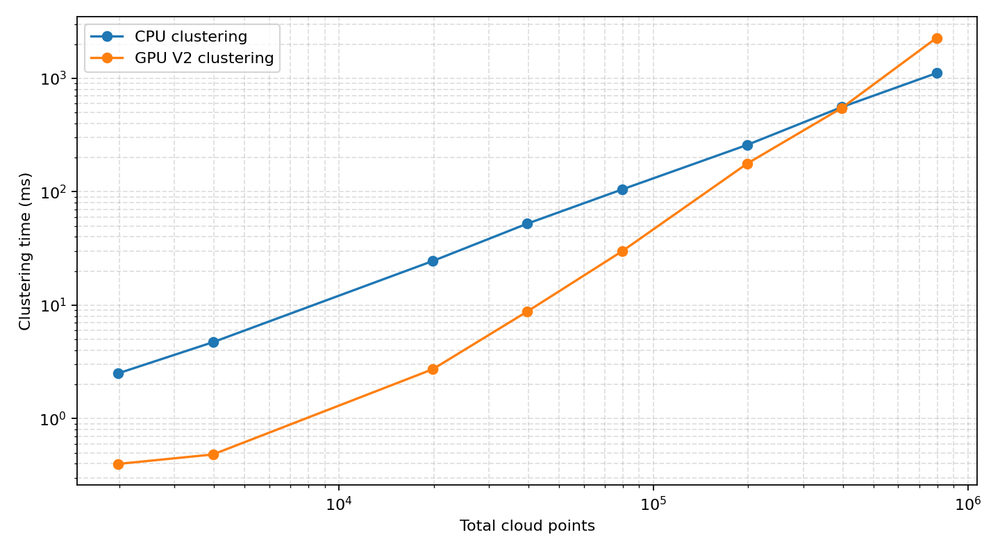

# Course Project
This is a final project for the **Coursera GPU Programming Specialization**, specifically the "CUDA Advanced Libraries" course. Throughout the specialization, each course presents a distinct set of challenges that deepen understanding of GPU programming with CUDA, including when and what to run on a GPU and how to improve the performance of well-known algorithms. This open-ended project requires students to choose their own problem and implement a solution using the GPU programming concepts learned throughout the course series.

# Pointcloud Euclidean clustering

## Project goals and motivations:
With this context, the project investigates the parallel processing power of GPUs for a well-known problem: Euclidean clustering of 3D points. It is a course-level project, not a cutting-edge reimplementation or a replacement for existing implementations. Following the course guidelines, I chose a problem that I found interesting and feasible to implement within the scope of the coursework.

I have regularly worked with point-cloud algorithms, including segmentation, clustering, and shape detection, mostly through the well-known PCL library. I have occasionally encountered cases where an algorithm's frame rate drops substantially when the number of input points grows by one or two orders of magnitude. Many modern 3D LiDARs produce roughly 30,000 to 60,000 points per frame. Although most algorithms process only a relevant subset of those points, some problems require analysis of the complete set. For CPU-based PCL algorithms, even those with $O(N)$ complexity, processing times can reach several seconds as the number of input points grows by one or two orders of magnitude.

This led me to consider point clouds as strong candidates for parallelizing the low-level calculations used by these algorithms. To test this idea, I chose the widely used Euclidean clustering algorithm, implemented a GPU version, and compared it with PCL's CPU implementation.

## Build And Run In Docker container

The development environment is defined by the [dockerfile](dockerfile). It installs CUDA 12.2, CCCL, and PCL with GPU support. From the repository root on a host with Docker and the NVIDIA Container Toolkit installed, build the image using the same tag expected by `launch_container.sh`:

```bash
docker build \
	--build-arg USER_UID="$(id -u)" \
	--build-arg USER_GID="$(id -g)" \
	--build-arg USERNAME="$(id -un)" \
	--tag pcl_cuda_cccl:cu-12.2 \
	--file dockerfile .
```

Start the GPU-enabled development container. The script mounts the current repository into `/workspace`, so run it from the repository root:

```bash
./launch_container.sh
```

Inside the container, configure and build the project:

```bash
cmake -S /workspace -B /workspace/build -DCMAKE_BUILD_TYPE=Release
cmake --build /workspace/build --parallel
```

Run the main comparison with the bundled bunny point cloud. The first optional argument is the cluster tolerance; the second replicates the bunny cloud into that many separated clusters:

```bash
/workspace/build/cuda_euclidean_clustering_main 0.02 1
```

Generate benchmark CSV data and plot it:

```bash
cd /workspace/build
./create_benchmarks > benchmarks.csv
python3 ../plot_benchmarks.py benchmarks.csv --output benchmark_times.png
```

## Two versions of GPU implementations:

### a. Naive implementation:
`CudaEuclideanClustering::extract()` is a depth-first connected-component traversal. Euclidean clustering treats two points as connected when their Euclidean distance is less than or equal to the cluster tolerance. A cluster contains every point reachable through a chain of such connections.

For each still-unvisited seed point, the implementation:

1. Adds the seed to a device-side work queue.
2. Pops one queued point and performs a PCL GPU octree radius search using the cluster tolerance.
3. Filters returned neighbors against the visited array, appends new neighbors to the queue, and marks them visited.
4. Repeats until the queue is empty, then copies the accumulated point indices to the host as one cluster.
5. Starts again from the next unvisited point.

## Limitations:
This version is intentionally naive and is not an efficient GPU algorithm. It was designed to mimic the PCL's CPU version, only using the GPU where the PCL's CUDA-based API would allow. It launches a radius search for one query point at a time, downloads the selected point and neighbor count, allocates temporary buffers repeatedly, and lets the host control the queue traversal. PCL's legacy GPU radius-search wrapper also synchronizes the device after each query. Those small launches, synchronization points, host-device transfers, and repeated allocation costs dominate the actual distance calculations. As the input grows, the result is impractically high runtime despite using a GPU for individual neighbor searches.

**Conclusions:** This method is not added to the benchmarking due to the above reasons.

### b. All-pairs union-find implementation:
`CudaEuclideanClustering::extractV2()` takes a different view of the same problem. Instead of repeatedly asking “what are the neighbors of this one point?”, it builds the connectivity graph implicitly by testing all unique point pairs in parallel.

For every pair `(i, j)` with `i < j`, a CUDA kernel calculates squared distance. If that distance is within the tolerance, the pair is joined with a parallel union-find data structure. Each point begins in its own set:

```text
point:   0  1  2  3  4
parent:  0  1  2  3  4
```

If the close pairs are `0-1`, `1-2`, and `3-4`, the union operations produce two connected components:

```text
parent:  0  0  0  3  3
clusters: {0, 1, 2} and {3, 4}
```

`atomicCAS` safely merges two concurrently discovered sets. A later path-compression kernel makes every point reference its final root. The implementation sorts `(root, point_index)` pairs by root, so all indices belonging to one component become contiguous and can be copied to a `pcl::PointIndices` cluster.

This removes the per-point octree search, repeated queue management, and repeated host-device transfers used by the naive version. It does not store an `N x N` distance matrix; it evaluates the upper-triangular pairs directly in a 2D CUDA launch.

The cost is $O(N^2)$ distance tests. This must be kept in perspective: a cloud with one million points has roughly $5 \times 10^{11}$ unique pairs, and multi-million-point clouds require trillions of pair tests. Those sizes are generally impractical for a single current-generation LiDAR frame, however. Many modern LiDARs produce tens of thousands of points per frame, and a practical target below 100,000 points is the range considered by this project.

Within that practical range, the benchmark results show the all-pairs GPU implementation outperforming PCL's CPU Euclidean clustering implementation on the test hardware. The GPU can evaluate a very large number of independent distance tests concurrently, so the quadratic work is still usable at these input sizes. This does not make the approach universally scalable: dense clusters can also cause contention in the parallel union operations, and a production implementation intended for much larger clouds should use spatial partitioning, such as a uniform grid or spatial hash, to compare only nearby points.

## Benchmarking

The `create_benchmarks` executable compares PCL's CPU Euclidean clustering implementation with `extractV2()`, the all-pairs GPU implementation. It writes CSV data to standard output with these columns:

```text
no_of_clusters,total_cloud_points,cpu_clustering_ms,gpu_clustering_ms
```

Run it from the build directory and redirect its CSV output:

```bash
./create_benchmarks > benchmarks.csv
```

Progress messages are written to standard error so they do not corrupt the CSV. The `plot_benchmarks.py` script reads that CSV and generates a two-curve plot of CPU and GPU clustering time against total cloud points:

```bash
python3 ../plot_benchmarks.py benchmarks.csv --output benchmark_times.png
```

The plot uses logarithmic axes because both the point counts and the all-pairs GPU runtime span large ranges.

## PCL CUDA Benchmark Attempt

The project also attempted to benchmark [PCL's CUDA/GPU Euclidean clustering implementation](https://pointclouds.org/documentation/classpcl_1_1gpu_1_1_euclidean_cluster_extraction.html). On the replicated-cloud inputs used here, it produced unexpected cluster results that did not agree with the known synthetic structure or with PCL's CPU implementation. Because the GPU result could not be treated as a correctness baseline for these inputs, it is not included in the timing benchmark. PCL CPU clustering remains the reference implementation used for the comparison.

## Test Point Cloud And Scaling Method

`/workspace/data/bunny.pcd` is the base test cloud used by the executable and benchmark. It contains points from the Stanford bunny mesh and is dense enough for clustering tests.

To increase the number of points without changing the local shape of a cluster, `gridReplicate()` creates translated copies of the original bunny cloud. The copies are placed on a 3D grid with a gap slightly larger than the clustering tolerance, so each copy should remain a separate Euclidean cluster. The benchmark uses increasing copy counts to increase the total number of points while retaining a known expected cluster structure.

This approach tests scaling with more points and more disconnected components without requiring a large ground-truth dataset. It does not model every property of a real LiDAR scene: the local density and geometry of every replicated cluster are identical. It is nevertheless useful for exposing the difference between the CPU KD-tree approach and the GPU all-pairs approach as input size grows.

Production pipelines commonly downsample before clustering to reduce work, but this benchmark deliberately uses the original cloud. Replication can reach the same input sizes without changing the base cloud's local geometry.

For every replicated input, the benchmark also validates the expected synthetic structure: it must find one cluster per bunny copy, and each returned cluster must contain the same number of points as the original bunny cloud.



The log plot shows that V2 is clearly faster through about 80,000 points, approaches the CPU result near 200,000 points, and becomes slower beyond roughly 400,000 points. This happens because V2 compares more point pairs as the cloud grows. A GPU uniform grid or spatial hash could limit comparisons to nearby points, while staged connected-components processing could reduce union-find contention.

> **NOTE!!** These results were measured on an NVIDIA GeForce RTX 4080 Laptop GPU. Absolute timings and the exact crossover point can vary with GPU model, power limits, memory bandwidth, and host CPU performance. However, the overall trend should remain broadly similar on CUDA-capable GPUs because this implementation does not rely on Tensor Cores, CUDA Graphs, multi-stream execution, cooperative kernel launches, or architecture-specific instructions.

## Future Improvements

The all-pairs GPU implementation is useful for studying parallel connectivity, but its $O(N^2)$ pair testing limits the cloud sizes it can process. Possible GPU-focused improvements include:

**Implementation improvements:**

- Use a GPU uniform grid or spatial hash to compare only points in nearby cells.
- Use GPU sorting and prefix sums to build compact cell ranges and balance work across dense and sparse regions.
- Reduce union-find contention with staged connected-components processing, and keep label compaction and cluster-index generation on the GPU.
- Compare with validated PCL GPU and optimized CPU baselines using equivalent parameters.

**Benchmarking improvements:**

The synthetic bunny benchmark could be supplemented with public point-cloud datasets: KITTI or SemanticKITTI for driving LiDAR, nuScenes or Waymo Open Dataset for urban scenes, and Stanford 3D Scanning Repository scans for indoor geometry. Preprocessing and clustering parameters should remain consistent across implementations.

Timing alone does not establish that two clustering implementations produce the same partition. More rigorous correctness testing could include:

- Hand-authored edge cases, such as isolated, duplicate, chain-connected, and boundary-distance points.
- Randomized differential tests against PCL CPU clustering with identical parameters.
- Partition metrics such as adjusted Rand index, pairwise F1 score, and per-cluster intersection-over-union when labels are available.
- Property-based checks for size limits, unique point membership, and agreement with the tolerance graph, plus repeated CUDA error-checked runs.

